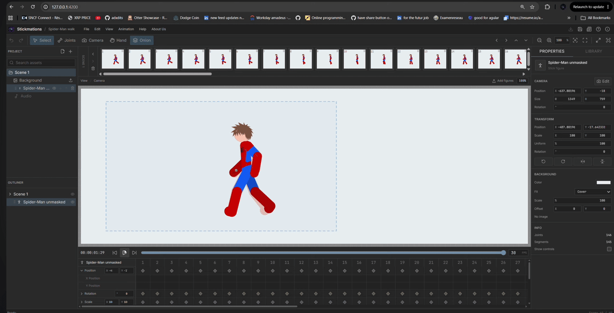

<p align="center">
  
</p>

<h1 align="center">Stickmations</h1>

<p align="center">
  A desktop editor for 2D stick-figure animation on Windows, macOS, and Linux.
</p>

<p align="center">
  <a href="https://adxdits.github.io/stickmations/#download"></a>
  &nbsp;&nbsp;&nbsp;
  <a href="https://discord.com/invite/5YQTaaC5W"></a>
  &nbsp;&nbsp;&nbsp;
  <a href="https://www.youtube.com/@StickmationsSoftware"></a>
</p>

## Demo

<p align="center">
  
</p>

## Installation

Choose a build for your operating system on the
[download page](https://adxdits.github.io/stickmations/#download).

Downloaded builds may show an unverified-publisher warning. On macOS, approve
the app in **System Settings > Privacy & Security > Open Anyway**.

## Development

### Requirements

- Node.js 22.12 and npm 10.9
- [nvm](https://github.com/nvm-sh/nvm) to use the Node.js version in `.nvmrc`

### Setup

Run these commands from the repository root:

```bash
nvm install
nvm use
npm install
npm run check
```

Keep npm commands at the repository root. All workspaces share one
`package-lock.json`.

### Run the app

```bash
npm run dev
```

This starts the Angular development server and opens the editor in Electron.
Use `npm start` to build and launch the production desktop app, or
`npm run dev:website` to run the download website separately.

### Commands

| Command               | Purpose                                     |
| --------------------- | ------------------------------------------- |
| `npm run dev:website` | Serve only the public download website      |
| `npm run build:app`   | Build only the desktop application          |
| `npm run build`       | Build every workspace                       |
| `npm test`            | Run engine, editor, and website tests once  |
| `npm run typecheck`   | Type-check the engine and Electron sources  |
| `npm run check`       | Build, test, and type-check every workspace |
| `npm run dist:mac`    | Build macOS DMG and ZIP artifacts           |
| `npm run dist:win`    | Build Windows installer and portable EXE    |
| `npm run dist:linux`  | Build Linux AppImage and Debian package     |

In VS Code, the `Stickmations: Dev` and `Stickmations: Check` tasks run the
development server and checks. Recommended extensions are listed in the workspace.

## Releases

Releases are built on native GitHub-hosted runners, with an FFmpeg binary for
each operating system and CPU architecture. Each release includes:

- macOS DMG and ZIP files for Apple Silicon and Intel
- Windows x64 installer and portable executable
- Linux x64 AppImage and Debian package
- `SHA256SUMS.txt` covering every download

Assets are published alongside the source code in this repository's
[GitHub Releases](https://github.com/adxdits/stickmations/releases).
The release workflow verifies the packages and smoke-tests bundled FFmpeg before
publishing. macOS packages use ad-hoc signing, not a verified publisher signature.

### Publishing a release

The workflow uses GitHub Actions' built-in `GITHUB_TOKEN`, with Contents write
permission limited to the publish job. No separate release token is needed.

Before publishing a release under the new licensing terms, choose a new
version and tag containing the source and license for that release. Update the
package versions and website download configuration together. Do not reuse
historical release tags, which still identify the source and license for those
older versions.
The workflow rejects existing tags that point to a different commit than the
one being built.

Run `npm run check` before publishing. Then either:

- Push a version tag such as `v1.2.3` to start the release workflow.
- Run the **Release desktop apps** workflow from `main`, with `release_tag` set
  to the package version prefixed with `v`.

The workflow builds every platform and publishes the assets and checksums to
this repository, replacing existing assets for that release. New tags point to
the exact commit used for the build, and release notes link to that source.

### Publishing the website

The download website deploys separately when website files reach `main`, using
`.github/workflows/deploy-website.yml`. It is hosted on
[GitHub Pages](https://adxdits.github.io/stickmations/).

## Architecture

- `engine/` - Framework-free figure import, domain model, and kinematics.
- `frontend/` - Angular editor application loaded by Electron.
- `website/` - Independent Angular application for the public download website.
- `desktop/` - Electron main process and isolated preload boundary.

The editor and website have separate entry points, dependencies, builds, and
tests. Neither imports the other. The engine is independent of Angular and
Electron.

See [Frontend architecture](docs/frontend-architecture.md) for the editor's
feature, state, domain, rendering, and testing boundaries.

## License

Copyright (c) 2026 Adam Almounayar (adxdits).

Stickmations is free for personal, non-commercial use under the
[Stickmations Personal and Commercial License](LICENSE). It is source-available,
not open-source. Commercial use requires a separate paid license for both
individuals and companies, including internal business use, paid work, client
projects, advertising, and monetized content.

Redistribution or sale of the software, including modified versions, requires
separate written permission. These restrictions apply to the software, not
ownership of original animations you create with it. The software is provided
without warranty to the extent permitted by law, as described in the license.

### Commercial licensing

A paid commercial license must be obtained before using Stickmations for
business or commercial purposes. Contact
[adamalmounayar@hotmail.com](mailto:adamalmounayar@hotmail.com) for pricing and
written terms. Access to the source code does not grant commercial-use or
redistribution rights.

These terms apply only to code and assets we own or have the right to relicense.
Third-party components, including FFmpeg, retain their own licenses and any
applicable notice and corresponding-source requirements. Historical releases
remain under the licenses distributed with those versions; existing GPL rights
are not revoked.
